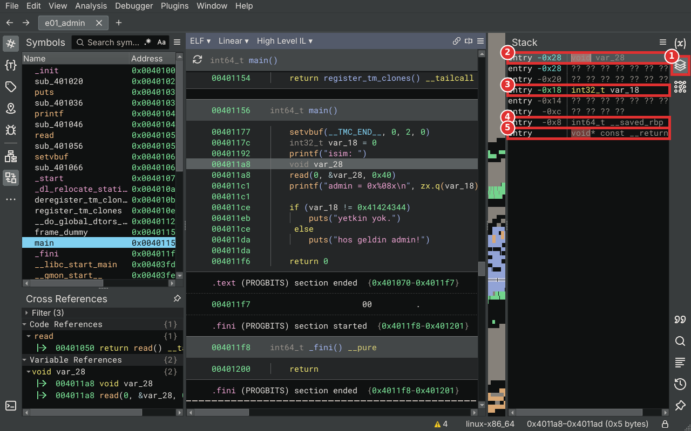
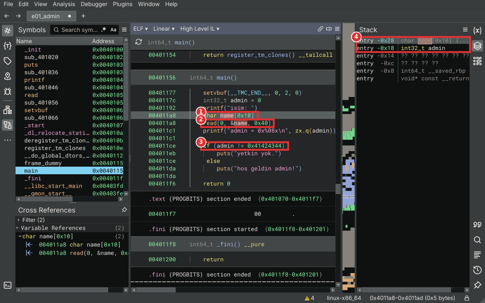

# Bölüm 08: Yığın ve değişkenler

Exploit yazarken Binary Ninja'dan en çok bir şey istersin: bir buffer'ın dönüş adresine ne kadar uzak olduğu. Bu bölüm o sayıyı nasıl okuyacağını anlatıyor.

## var_ isimleri nereden geliyor

Binary Ninja yığındaki bir değişkene isim verirken, fonksiyona girildiği andaki `rsp`'yi sıfır noktası alır. O anda `rsp` dönüş adresini gösterir. Bir değişken o noktanın `0x28` bayt altında başlıyorsa adı `var_28` olur.

Stack paneli bunu açıkça gösteriyor. Sağ kenar çubuğundaki katmanlar simgesine tıkla:

*e01_admin'in main fonksiyonunda Stack paneli.*

1. Stack panelini açan simge.
2. `entry -0x28  void var_28`: buffer, fonksiyona girişteki `rsp`'nin `0x28` bayt altında.
3. `entry -0x18  int32_t var_18`: `admin` değişkeni.
4. `entry -0x8  int64_t __saved_rbp`: fonksiyonun başındaki `push rbp`'nin kaydettiği değer.
5. `entry  void* const __return_addr`: **dönüş adresi**, tam sıfır noktasında.

`entry -0x28` ifadesini "fonksiyona girişteki `rsp`'den `0x28` aşağıda" diye oku. Dönüş adresi `entry`'nin kendisi olduğuna göre:

- **`var_XX` adındaki bir buffer'dan dönüş adresine mesafe `0xXX`'tir.** Hiç hesap yapmadan.
- İki değişken arasındaki mesafe, adlarındaki sayıların farkıdır: `0x28 − 0x18 = 0x10`.
- Assembly'de `[rbp-X]` olarak görünen değişkenin adı `var_(X+8)` olur. Disassembly görünümünde zaten yan yana yazıyor: `[rbp-0x20 {var_28}]`.

| Program | Assembly'de | Binary Ninja'da | Dönüş adresine |
|---|---|---|---|
| `e01_admin` `name` | `[rbp-0x20]` | `var_28` | `0x28` = 40 |
| `e01_admin` `admin` | `[rbp-0x10]` | `var_18` | |
| `e02_win` `buf` | `[rbp-0x20]` | `var_28` | 40 |
| `e03_shell` `buf` | `[rbp-0x80]` | `var_88` | 136 |
| `e05_libc` `buf` | `[rbp-0x20]` | `var_28` | 40 |
| `e07_canary` `buf` | `[rbp-0x50]` | `var_58` | 88 |
| `e07_canary` canary | `[rbp-0x8]` | `var_10` | |

`e01`, `e05` ve `e07` satırları Binary Ninja ekranında görüldü. Diğerleri aynı kurala göre hesaplandı.

## Buffer'ın boyutunu düzeltmek

Binary Ninja buffer'ın boyutunu her zaman bilemez. `e01_admin`'de `var_28`'i `void` sanmıştı. Bölüm 6'da `y` ile `char name[16]` yaptık:

*İsim ve tip verildikten sonra main.*

1. `char name[0x10]`: buffer artık 16 baytlık bir dizi.
2. `read(0, &name, 0x40)`: 16 baytlık diziye 64 bayt okunuyor. Hata artık tek satırda göze çarpıyor.
3. `if (admin != 0x41424344)`: isimler HLIL'in her yerinde değişti.
4. Stack panelinde de `char name[0x10]` ve `int32_t admin` görünüyor.

Bazen Binary Ninja boyutu kendisi doğru tahmin eder. `e07_canary`'de buffer'ı kendiliğinden `char var_58[0x48]` yaptı. `0x48` = 72, buffer'ın başından canary'ye kadar olan mesafe. Bunu Bölüm 10'da göreceksin.

## Variables paneli

Sağ kenardaki `(x)` simgesi Variables panelini açar: fonksiyonun yerel değişkenleri türleriyle birlikte. Bir değişkene tıklayınca kodda kullanıldığı her yer vurgulanır.

## rbp kullanılmayan kodda

`-O2` ile derlenmiş programlarda (örneğin `p01_gate`) derleyici `rbp`'yi çerçeve için kullanmayabilir. Assembly'de `[rsp+0x20]` gibi adresler görürsün ve aynı değişkenin `rsp`'ye göre uzaklığı fonksiyon boyunca değişebilir. Binary Ninja için bu fark etmez: `var_` isimleri yine `entry`'ye göre verilir. Bu yüzden `-O2` kodda `var_` isimleri, assembly'den daha güvenilir bir rehber.

---

[← 01-arayuz-ve-temeller](01-arayuz-ve-temeller.md) · [İçindekiler](README.md) · [03-uygulamalar →](03-uygulamalar.md)
