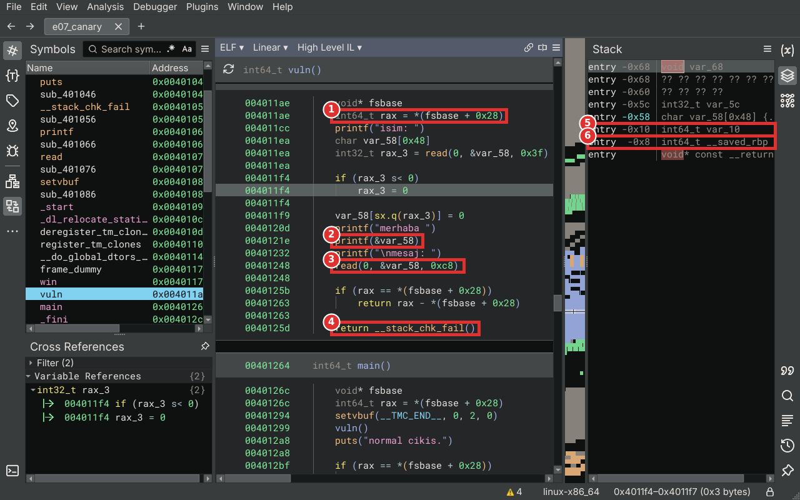
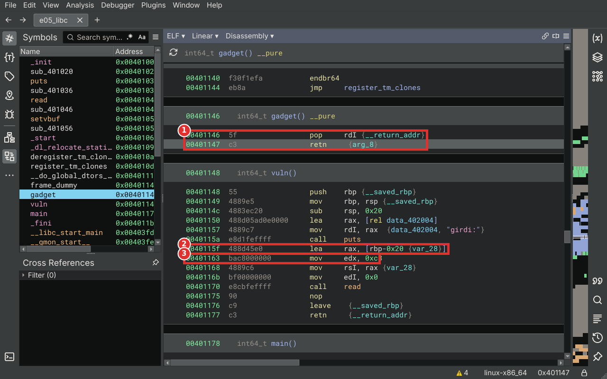
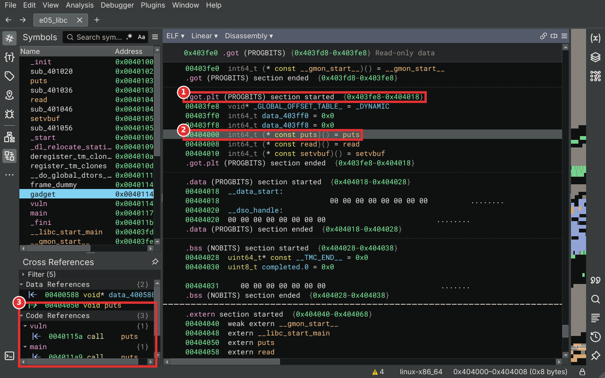
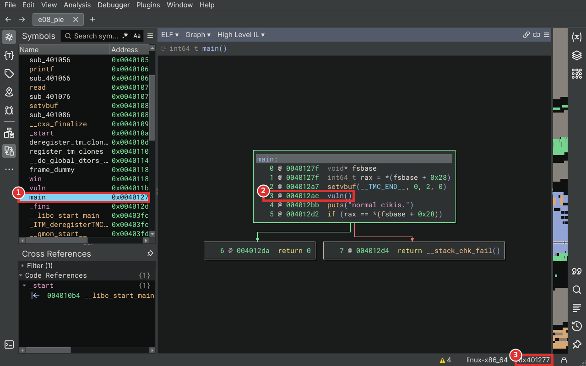
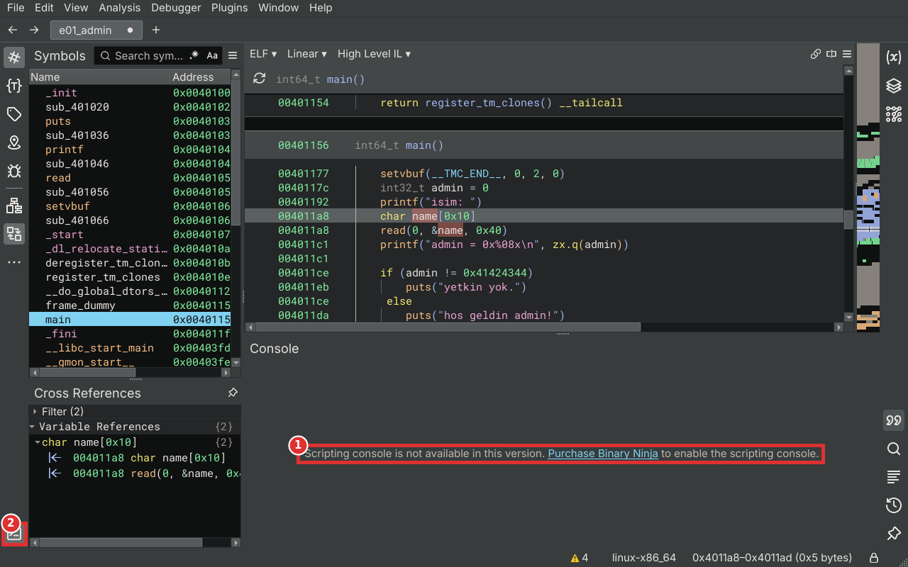

> **Kısım II · Uygulamalar.** Kitaptaki örnek programlar üzerinde Binary Ninja ile adım adım çalışmak.


# Bölüm 09: Uygulama 1: e01_admin

Bu uygulamada gdb'ye dokunmadan, sadece Binary Ninja ile `e01_admin`'in hatasını bulup exploit için gereken iki sayıyı çıkaracağız. Bu bölümdeki görüntülerin hepsini önceki bölümlerde gördün. Burada onları bir iş akışı olarak bir araya getiriyoruz.

**1. Aç.** `binaryninja ~/cracks/e01_admin`. Karşılama penceresinde `Start`.

**2. `main`'e git.** Symbols panelinde `main`'e çift tıkla. Senin ayarlarınla Graph + HLIL açılır (Bölüm 4'teki ilk görüntü).

**3. HLIL'i oku.** Ekranda tam olarak şu var:

```c
setvbuf(__TMC_END__, 0, 2, 0)
int32_t var_18 = 0
printf("isim: ")
void var_28
read(0, &var_28, 0x40)
printf("admin = 0x%08x\n", zx.q(var_18))
if (var_18 != 0x41424344)
```

Girdi `var_28`'e okunuyor, boyutu `0x40`. Karar `var_18`'e bağlı. `var_18`, `var_28`'den sonra geliyor (daha küçük sayı = dönüş adresine daha yakın = daha yüksek adres).

**4. İsim ver.** `var_28` → `name`, `var_18` → `admin` (`n`).

**5. Mesafeyi oku.** Stack paneli: `name` `-0x28`, `admin` `-0x18`. Fark `0x10` = 16. `Ctrl+Shift+P` → `=0x28-0x18` → `0x10`.

**6. Boyutu düzelt.** `name`'in üstünde `y` → `char name[16]`. HLIL artık `read(0, &name, 0x40)` diyor: 16 baytlık diziye 64 bayt.

**7. Exploit.** 16 bayt dolgu, ardından `0x41424344` little-endian (`DCBA`):

```bash
printf 'AAAAAAAAAAAAAAAADCBA' | ~/cracks/e01_admin
```

```text
isim: admin = 0x41424344
hos geldin admin!
```

Exploit kitabının Bölüm 7'sinde aynı sayıları `objdump` ile satır satır bulmuştuk. Burada iki isim ve bir çıkarma işlemi yetti.

**8. Kaydet.** `Ctrl+S`.

# Bölüm 10: Uygulama 2: e07_canary

Bu programda iki hata var. İkisini de Binary Ninja'da bulacağız, canary'nin nasıl göründüğünü ve format string yuvasının nasıl hesaplandığını göreceğiz.

`binaryninja ~/cracks/e07_canary`, sonra Symbols'ten `vuln`, `Space` ile Linear, ve Stack paneli:



*e07_canary'nin vuln fonksiyonu, Linear HLIL ve Stack paneli.*

1. `int64_t rax = *(fsbase + 0x28)`: **canary yükleniyor.** `fsbase + 0x28`, assembly'deki `fs:0x28`.
2. `printf(&var_58)`: **format string hatası.** `printf`'in ilk argümanı sabit bir metin değil, yığındaki buffer.
3. `read(0, &var_58, 0xc8)`: **taşma.** `0xc8` = 200 bayt, buffer ise 72.
4. `return __stack_chk_fail()`: canary bozulmuşsa program burada ölür. Bir fonksiyonun sonunda bu çağrıyı gördüğün her yerde canary var demektir.
5. Stack panelinde `entry -0x58  char var_58[0x48]`: buffer. Binary Ninja boyutunu kendisi `0x48` = 72 tahmin etmiş, yani canary'ye kadar.
6. `entry -0x10  int64_t var_10`: canary'nin yığındaki yeri. Hemen altında `-0x8 __saved_rbp`.

Hataları `x` ile de bulabilirdin: `printf`'in üstünde `x` dersen bütün çağrılar listelenir. İlk argümanı sabit metin olmayan tek çağrı `printf(&var_58)`. `read` için de aynısı: iki çağrıdan biri `0x3f`, diğeri `0xc8` okuyor.

**Mesafeler:**

| Ne | Stack panelinde | Hesap |
|---|---|---|
| buffer → canary | `-0x58` → `-0x10` | `0x58 − 0x10 = 0x48` = **72** |
| buffer → dönüş adresi | `-0x58` → `entry` | `0x58` = 88 |

**Format string yuvası.** Stack panelinin en üst satırı `entry -0x68`: fonksiyonun girişindeki `sub rsp,0x60`'tan sonra yığının tepesi orada. `printf(buf)` çağrıldığında `%6$p` yığının tepesini okur ve her yuva 8 bayt aşağı iner. Canary `-0x10`'da:

```text
N = 6 + (0x68 − 0x10) / 8 = 6 + 11 = 17
```

`Ctrl+Shift+P` → `=6+(0x68-0x10)/8` yazarsan sonuç `0x11` = 17 çıkar. Exploit kitabındaki `%17$p`.

Doğrulamak için programın kendisine sor:

```bash
(printf '%%17$p'; sleep 0.2; printf 'x') | ~/cracks/e07_canary
```

`00` ile biten rastgele bir sayı görmelisin. O sayı canary.

# Bölüm 11: Uygulama 3: gadget, GOT ve PIE

## e05_libc: gadget ve GOT

`binaryninja ~/cracks/e05_libc`. Symbols'ten `gadget`'a çift tıkla, `Space` ile Linear, `Tab` ile Disassembly:



*e05_libc: gadget ve vuln, Linear Disassembly.*

1. `gadget` fonksiyonu `0x401146`'da: `5f  pop rdi` ve `c3  retn`. Satırın ortasındaki `5f` ve `c3` komutların baytları. Exploit kitabında `ret = pop_rdi + 1` yazmamızın sebebi bu iki bayt.
2. `lea rax, [rbp-0x20 {var_28}]`: `vuln`'ün buffer'ı. Dönüş adresine 40.
3. `mov edx, 0xc8`: `read`'e verilen boyut, 200.

Şimdi `g` ile `404000` adresine git:



*0x404000: puts'un GOT kutusu.*

1. `.got.plt` bölümü `0x403fe8`–`0x404018` arasında. Exploit kitabının Bölüm 14'ündeki GOT bu.
2. `0x404000  int64_t (* const puts)() = puts`: `puts`'un kutusu. Binary Ninja onu bir fonksiyon işaretçisi olarak göstermiş. pwntools'taki `e.got.puts` = `0x404000` bu adres.
3. Cross References panelinde `puts`'u çağıran kodlar: `vuln` ve `main`.

## e08_pie: Binary Ninja PIE programı nereye yükler

`binaryninja ~/cracks/e08_pie`:



*e08_pie'nin main fonksiyonu.*

1. Symbols panelinde `main` → `0x401277`.
2. `vuln()` çağrısı `0x4012ac`'te.
3. Durum çubuğunda imlecin adresi `0x401277`.

`nm` aynı program için `main`'i `0x1277` olarak gösterir. Demek ki **Binary Ninja bu PIE programı `0x400000` tabanına yüklemiş.** Binary Ninja'daki bir adresten offset'i bulmak için `0x400000` çıkar:

| Nerede | `main` | `call vuln`'den sonraki komut |
|---|---|---|
| `nm` / `objdump` (offset) | `0x1277` | `0x12b1` |
| Binary Ninja | `0x401277` | `0x4012b1` |
| gdb (ASLR kapalı) | `0x555555555277` | `0x5555555552b1` |

Binary Ninja'dan gdb'ye bir adres taşırken: `gdb adresi = 0x555555554000 + (Binary Ninja adresi − 0x400000)`. Pratikte gdb'de `b *main+0x3a` gibi sembole göre yazmak daha kolay. Sembol tabanından bağımsızdır.

Exploit kitabının Bölüm 18'inde PIE tabanını `sızan adres − 0x12b1` ile hesapladık. `0x12b1`'i Binary Ninja'dan `0x4012b1 − 0x400000` olarak da bulursun.

# Bölüm 12: Bir crackme'ye nereden başlanır

Crackme'de genelde taşma aramazsın. Programın girdiyi nasıl kontrol ettiğini anlamaya çalışırsın. IOLI serisine bu sırayla gir:

1. **Programı bir kere normal çalıştır.** Ne istiyor, yanlış girince ne diyor?
2. **Metinden başla.** Strings panelinde o "yanlış" mesajını bul.
3. **Geriye git.** Metnin üstünde `x`. Onu yazdıran koda git. Grafik görünümünde o kutuya hangi `if`'ten geldiğine bak. Yeşil ok "koşul doğru", kırmızı ok "koşul yanlış".
4. **Karşılaştırmayı bul.** Koşulun içinde bir `strcmp`, bir sayı karşılaştırması ya da bir döngü var. HLIL'de oku.
5. **Girdiyi takip et.** Girdinin okunduğu yeri (`scanf`, `fgets`, `read`) bul, buffer'a `n` ile `input` adını ver, sonra `x` ile kullanıldığı her yere bak.
6. **İsim ver.** Yardımcı fonksiyonlara yaptıkları işin adını ver.
7. **gdb'de doğrula.** "Bu koşul şuna bakıyor" dediğin yere kesme noktası koy ve değerleri kendi gözünle gör.

Sembolleri silinmiş (stripped) programlarda `main` adı görünmez. Binary Ninja genelde `_start`'tan `__libc_start_main`'e verilen ilk argümanı izleyerek `main`'i yine bulur. Bulamazsa `_start`'a git, `__libc_start_main` çağrısında `rdi`'ye konan adrese çift tıkla. `main` orası.

# Bölüm 13: Ücretsiz sürümün sınırları

Senin kurduğun Binary Ninja Free. Resmi belgelerde anlatılan bazı özellikler bu sürümde yok. Bunu bu makinede denedik.



*Free sürümde Python konsolu.*

1. "Scripting console is not available in this version.": **Python konsolu yok.** Resmi kılavuzdaki `bv`, `current_function` gibi bütün Python örnekleri bu sürümde çalışmaz.
2. Konsolu açan simge (sol alt). Ters tırnak tuşu (`` ` ``) da aynı paneli açar.

Bunun dışında Free sürümde:

- Ticari kullanım yok.
- Eklenti ve API kullanımı kısıtlı.
- Komut satırından (headless) analiz yok.

Bu kılavuzdaki her şey (görünümler, gezinme, çapraz referanslar, isim, tip, Stack paneli) Free sürümde çalışıyor. Hepsi bu makinede denendi.

# Bölüm 14: Kısayol kartı

Hepsi resmi belgelerdeki varsayılan Linux kısayolları. İşaretli olanlar (✓) bu makinede denendi.

## Gezinme

| Tuş | İş | |
|---|---|---|
| çift tık | Oraya git | ✓ |
| orta tık / `Shift` + orta tık | Yeni bölmede / yeni sekmede aç | |
| `Esc` | Geri | |
| `Ctrl+[` / `Ctrl+]` | Geri / ileri | |
| `g` | Adrese ya da ifadeye git | ✓ |
| `Ctrl+P` | Komut paleti (sadece komutlar) | ✓ |
| `Ctrl+Shift+P` | Her şeyde ara, `=` ile hesap makinesi | ✓ |
| `x` | Sabit çapraz referans listesi | ✓ |
| `Alt+x` / `Alt+Shift+x` | Sonraki / önceki referans | |

## Görünüm

| Tuş | İş | |
|---|---|---|
| `Space` | Linear ↔ Graph | ✓ |
| `Tab` / `F5` | HLIL ↔ Disassembly | ✓ |
| `i` | Disassembly → LLIL → MLIL → HLIL | |
| `h` | Hex görünümü | |
| `t` | Tip görünümü | |
| `w` / `z` | Grafiği sığdır / imlece yakınlaş | |

## Not alma ve tipler

| Tuş | İş | |
|---|---|---|
| `n` | İsim ver | ✓ |
| `y` | Tip ver | ✓ |
| `;` | Yorum | |
| `p` | Burada fonksiyon oluştur | |
| `u` | Tanımı kaldır | |
| `1` `2` `4` `8` / `d` | Tamsayı boyutu | |
| `a` / `o` / `*` | Metin / işaretçi / dizi | |
| `Ctrl+S` | Analiz veritabanını kaydet | |
| `Ctrl+Shift+B` | Kısayolları değiştir | |

## Binary Ninja → gdb

| Binary Ninja'da | gdb'de |
|---|---|
| `var_28`, Stack'te `entry -0x28` | `[rbp-0x20]`, dönüş adresine 40 |
| `entry -0x10` + `__stack_chk_fail` | canary, `[rbp-0x8]` |
| `printf(&var_58)` | format string, `%N$p` |
| PIE programda `0x401277` | offset `0x1277`, gdb'de `0x555555555277` |
| `call puts` → `0x401030` | `puts@plt` |
| `0x404000` (`.got.plt`) | `puts@got` |

# Bölüm 15: Kaynaklar

- **Resmi kılavuzun tamamı**, İngilizce: `~/cracks/Binary-Ninja-Kilavuzu.pdf`. Kaynağı github.com/Vector35/binaryninja-api deposunun `docs/` klasörü. Çevrimiçi: docs.binary.ninja.
- **Exploit Geliştirme kitabı**: `~/cracks/Exploit-Gelistirme.pdf`. Bu kılavuzdaki örnek programlar o kitaptan.
- **Binary Ninja blogu**: binary.ninja/blog. Yeni sürümler ve gerçek analiz örnekleri.

---

[← 02-yigin-ve-degiskenler](02-yigin-ve-degiskenler.md) · [İçindekiler](README.md)
